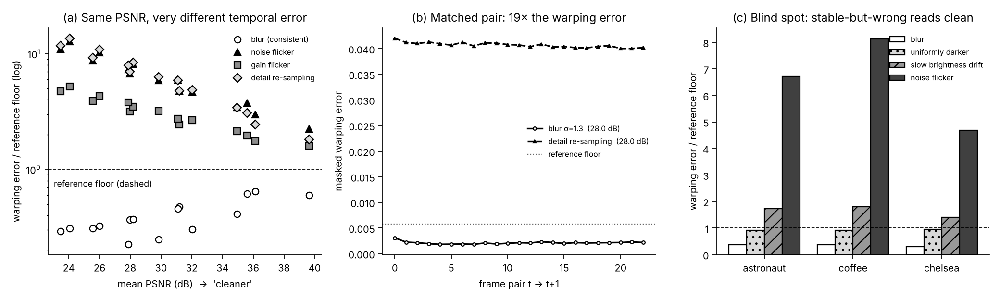

# Atlas — a motion-aware temporal fidelity harness

**Question:** when a video model (a tokenizer, a codec, a novel-view or world model) reconstructs a clip, does PSNR notice if the result *flickers*?

**Answer:** no. PSNR is computed frame by frame, so it has no term for how frames relate to each other. Atlas adds that term: it measures whether the reconstruction *moves the way the scene moves*.

At matched PSNR, temporally inconsistent reconstructions show **2.7× to 44× the warping error** of a temporally consistent one (median 13×, 45 PSNR-matched pairs, 3 scenes). The gap grows as quality drops. PSNR scores each pair as identical by construction.



## Method

For a reference clip `R` and reconstruction `X`:

1. **Motion from the reference.** Estimate optical flow `F(t→t+1)` and `B(t+1→t)` on `R`, not on `X`.
2. **Trust mask.** Keep pixels that pass a forward-backward consistency check (Sundaram 2010; Ruder 2016): following `F` and then `B` must bring a pixel back home. This drops occlusions, disocclusions and unreliable flow.
3. **Backward warp.** Pull `X(t+1)` back into frame `t`'s grid along `F`. Pulling (rather than pushing) gives every pixel exactly one value, with no holes or collisions.
4. **Warping error.** `E_t = mean over trusted pixels |X(t) − warp(X(t+1))|`. The same quantity computed on `R` itself is the **reference floor**: the residual that interpolation and flow error leave even for a perfect reconstruction. Results are reported raw and as a ratio to this floor.

**Prior work.** The warping-error measurement is not new. It follows Lai et al., *Learning Blind Video Temporal Consistency* (ECCV 2018), which warps output frames using flow from the input video and masks occlusions in the same way. Related temporal metrics include tOF and tLPIPS (Chu et al., TecoGAN, 2020). Atlas contributes the evaluation design around the measurement: PSNR-matched comparisons, a reference-floor control, flow validated against ground-truth motion, a second flow method as a cross-check, an ablation of where flow is measured, and an explicit blind-spot test.

**Why flow from the reference.** Flicker breaks brightness constancy, the assumption optical flow is built on. Estimating motion on the output means the thing being measured changes the instrument. In particular, the trust mask then covers a different set of pixels for each model under test. With the reference's motion, every reconstruction is scored on the same pixels against the same motion.

## Experiment

The scenes are synthetic, with ground-truth motion. A natural image (astronaut, coffee, chelsea from scikit-image) is filmed by a virtual camera that pans, zooms and rotates, while a foreground patch moves independently and creates occlusions. Each scene has 24 frames at 192×256. Because the motion is constructed, the flow estimator can be checked against ground truth before any of its numbers are used.

The reconstructions come in two families:

- **Consistent:** Gaussian blur, σ ∈ {0.6, 0.9, 1.3, 1.8, 2.5}, about 23–40 dB.
- **Inconsistent:** each strength is bisected so its mean PSNR equals the blur's to within 0.05 dB.
  - fresh Gaussian noise per frame
  - per-frame brightness gain jitter
  - "detail re-sampling": light blur plus freshly drawn band-pass texture per frame. This is a stand-in for a generative decoder re-hallucinating fine detail on every frame.

## Results (`results/summary.json`)

| | value |
|---|---|
| Flow accuracy (DIS) vs ground truth | 0.12–0.26 px EPE; trust-mask coverage 92–97% |
| Warping error / floor, consistent family | 0.22–0.65 |
| Warping error / floor, inconsistent family | 1.6–13.6 |
| Inconsistent / blur at matched PSNR | noise 3.8–41× (median 18), gain 2.7–17× (median 8.8), detail re-sampling 3.0–44× (median 19) |
| Independent flow method (Farneback), σ = 1.3, noise flicker | 9.2–12.1× (DIS: 15–22×). Same direction, smaller magnitude. |

Findings worth stating:

- **SSIM is also blind to brightness flicker.** Gain-flicker reconstructions keep SSIM ≥ 0.974 while their warping error is up to 17× the blur's. SSIM does penalize noise flicker, since that damages local structure.
- **The ratio depends on the operating point.** It grows as PSNR falls, partly because blur smooths away the interpolation residual (it sits *below* the floor) while flicker adds to it. A single "N×" is meaningless without the setting attached. The ratio to the reference floor is the more conservative number.
- **Ablation, flow on the reconstruction.** With DIS, measuring flow on the flickering output changed the score by under 1% to 10% (always lower). However, flow error rose 1.3–3.4×, and trust-mask coverage fell by up to 14 points (92% → 78% on one scene). The score was stable here, but the pixel set was not. That is the practical reason to measure motion on the reference.

## Blind spot (by design)

Atlas measures **self-consistency over time, not correctness**. At matched PSNR:

- a uniformly darker clip reads 0.92–0.94× floor, i.e. *clean*
- a slow brightness drift reads 1.4–1.8×
- noise flicker reads 4.7–8.1×

Stable-but-wrong passes. Atlas is a complement to a reference metric, not a replacement: PSNR or VMAF answers "is each frame right?", Atlas answers "do the frames agree with each other along the motion?"

## Limitations

- **Synthetic scenes and synthetic degradations.** Real tokenizer or codec outputs on real clips are the next run (`--flow raft` on GPU).
- **Flow error sets a floor.** Sub-floor differences are not interpretable.
- **No subjective study.** Agreement with human flicker judgments has not been measured. The way to establish it is the VMAF approach: subjective scores on a graded set, then fit and validate.
- **Reference required.** For outputs with no reference (e.g. novel-view synthesis at unseen viewpoints), flow has to come from the output itself. The ablation above shows what that costs.

## Running it on a real tokenizer

`scripts/run_tokenizer.py` encodes and decodes one real clip with a video tokenizer, then reports:

- the reconstruction's PSNR, SSIM and warping error
- a **blur control bisected to the same PSNR**, so the ratio carries the same meaning as in the synthetic experiment
- a **seam test**: is the warping error higher on frame pairs that cross the tokenizer's latent-chunk boundaries (a causal 4× temporal tokenizer chunks frames as [0], [1–4], [5–8], …)? This uses a permutation test, so a small clip still yields an honest p-value.

```bash
# Wan 2.1 VAE (the tokenizer Cosmos-Predict2 builds on)
pip install torch torchvision diffusers transformers accelerate
python scripts/run_tokenizer.py --video my_clip.mp4 --backend wan21 --flow raft

# NVIDIA Cosmos-0.1 causal video tokenizer (TorchScript)
huggingface-cli download nvidia/Cosmos-0.1-Tokenizer-CV4x8x8 --local-dir ckpts/CV4x8x8
python scripts/run_tokenizer.py --video my_clip.mp4 --backend cosmos-jit --ckpt ckpts/CV4x8x8 --flow raft

# plumbing check: fake chunked tokenizer, no GPU or network needed
python scripts/run_tokenizer.py --video my_clip.mp4 --backend selftest --flow dis
```

Defaults are 33 frames at 320×512, sized for a 12 GB GPU. Use a clip with real camera motion. If pairs move less than about a pixel, use `--stride 2`. On the self-test, the seam test flags the injected chunk boundaries (boundary/interior excess 1.3×, p ≈ 0.002). That check confirms the plumbing, not a property of any real model.

## Reproduce

```bash
pip install -r requirements.txt
python scripts/run_experiment.py          # ~2 min CPU; writes results/
python scripts/run_experiment.py --flow raft   # optional, needs torch+torchvision
pytest -q
```

## Layout

```
atlas/flow.py      DIS / Farneback / RAFT backends, end-point error
atlas/warp.py      backward warp, forward-backward trust mask
atlas/metrics.py   PSNR, SSIM, reference motion, warping-error curve
atlas/degrade.py   consistent / inconsistent / consistent-but-wrong degradations, PSNR matching
atlas/synth.py     ground-truth-motion test sequences
scripts/run_experiment.py   synthetic PSNR-matched experiment
scripts/run_tokenizer.py    real tokenizer: matched blur control + latent-seam test
scripts/concept_sheets.py   explanatory figures
tests/             instrument checks (warp with GT flow, flow EPE, mask, PSNR matching)
```

MIT License · Ravi Movva
